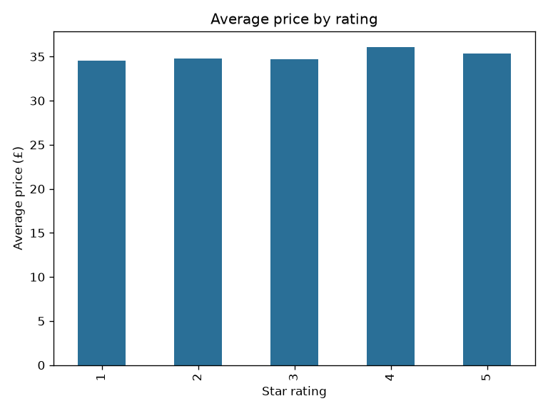

# Book Catalog Web Scraper

A small, polite web scraper built with Python that collects the full book catalog from [books.toscrape.com](https://books.toscrape.com) (a sandbox site created for scraping practice), cleans the data, and runs a quick analysis.


## What it does

- Crawls every listing page by following the **pagination** ("next") links
- Extracts **title, price, star rating, availability and product URL** for each book
- Respects the site: checks **robots.txt**, sends an identifying **User-Agent**, and **rate-limits** requests
- Handles failures with **retries and exponential backoff**
- Cleans types (price as float, rating as integer, stock as boolean) and removes duplicates
- Exports to **CSV** and produces a simple analysis (average price per rating)

## Tech stack

Python, Requests, BeautifulSoup4, Pandas, Matplotlib

## Project structure

```
book-scraper/
├── src/
│   ├── scraper.py     # crawling, parsing, cleaning, CSV export
│   └── analyze.py     # summary stats and chart
├── data/              # generated CSV (books.csv)
├── images/            # generated chart
├── requirements.txt
└── README.md
```

## Getting started

```bash
git clone https://github.com/NChalatsis/book-scraper.git
cd book-scraper
python -m venv .venv && source .venv/bin/activate   # Windows: .venv\Scripts\activate
pip install -r requirements.txt
```

Run the scraper (about 50 pages, roughly one minute with the default 1s delay):

```bash
python src/scraper.py
```

Useful options:

```bash
python src/scraper.py --max-pages 3      # quick test run
python src/scraper.py --delay 2          # slower, more polite
python src/scraper.py --output data/my_books.csv
```

Then run the analysis:

```bash
python src/analyze.py
```

## Output

`data/books.csv` columns:

| column | description |
|---|---|
| `title` | Book title |
| `price_gbp` | Price in GBP (float) |
| `rating` | Star rating, 1 to 5 (int) |
| `in_stock` | Availability (bool) |
| `url` | Product page URL |

## Results

Scraped **1,000 books** across 50 pages. Average price is roughly the same for every star rating (about £35), so price is not a good predictor of rating in this dataset.



## How it works

1. **`allowed_by_robots()`** verifies the start URL is permitted by robots.txt.
2. **`fetch()`** downloads a page using a shared `requests.Session`, retrying with backoff on network errors.
3. **`parse_page()`** uses CSS selectors to extract each book and finds the next-page link.
4. **`scrape()`** loops until there is no next page, sleeping between requests, and returns a deduplicated DataFrame.

## Scraping vs. APIs

Scraping is a fallback for when no API exists: it is more fragile because it depends on the page's HTML structure, and it requires care around terms of service and server load. When an API is available (as in my basketball project), it is the more stable and appropriate choice.

## Limitations and next steps

- Only listing pages are scraped; category and description from each product page could be added
- Dynamic JavaScript-rendered sites would need Selenium or Playwright instead of BeautifulSoup
- Possible additions: unit tests for the parser, a Streamlit dashboard, scheduled runs

## Disclaimer

For educational purposes. The target site is explicitly designed for scraping practice. Always check a website's terms of service and robots.txt before scraping.
